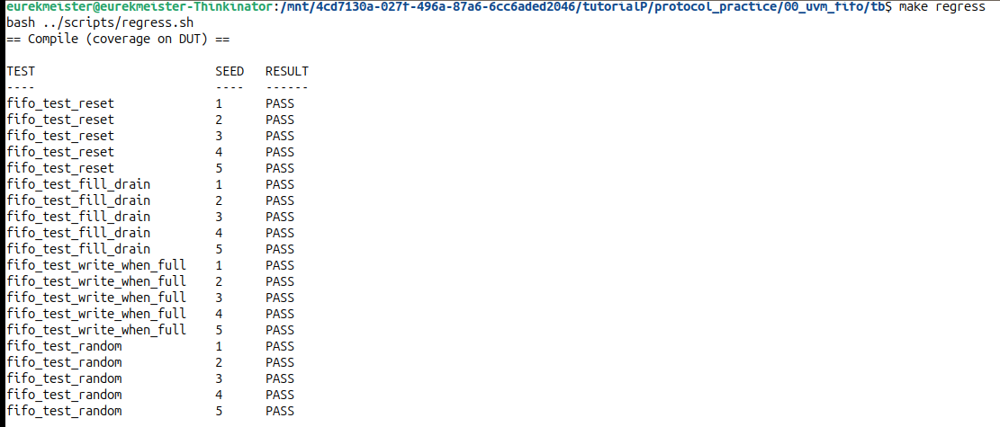
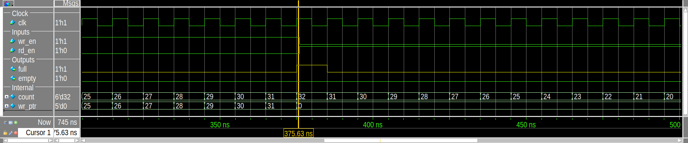
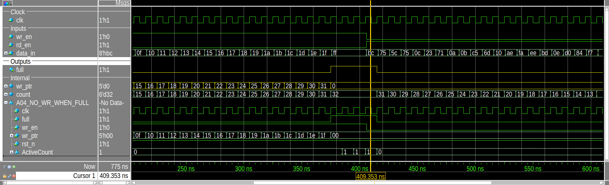
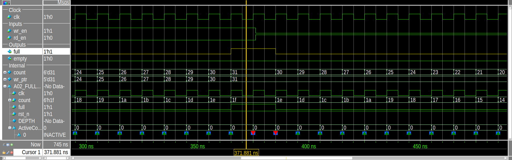
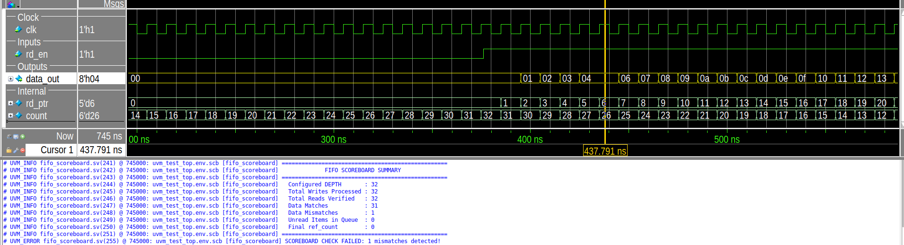

# Synchronous FIFO: UVM Verification

Verification of a parameterized synchronous FIFO with a UVM 1.1d testbench in SystemVerilog, run on Questa 2021.2.
The environment uses a reference-model scoreboard, functional coverage and ten assertions bound to the design. It was
validated by injecting five RTL bugs.

Full report: [doc/report/FIFO_Verification_Report.pdf](doc/report/FIFO_Verification_Report.pdf)
Verification plan: [doc/FIFO_VERIFICATION_PLAN.md](doc/FIFO_VERIFICATION_PLAN.md)

## Results

| | |
|---|---|
| Regression | 4 tests × 5 seeds = 20 runs, 20 pass |
| Scoreboard | 4,556 reads checked against the model, 0 mismatches |
| Functional coverage | 100% (24 of 24 bins) |
| Assertions | 10 of 10 active, 0 failures |
| Total coverage | 98.17% (statement and branch misses are one unreachable `default:`) |
| Bug injection | 5 of 5 injected bugs detected |



## Design under test

`rtl/sync_fifo.sv`, `sync_fifo #(DATA_WIDTH = 8, DEPTH = 32)`

- Single clock, synchronous active-low reset
- Register array with 5-bit read and write pointers
- Occupancy counter drives `full` (count = 32) and `empty` (count = 0)
- Write while full and read while empty are ignored
- `data_out` is registered

## Testbench

```
tb_top
 ├── sync_fifo (DUT) ── fifo_assertions (bind)
 ├── fifo_if (drv_cb, mon_cb)
 └── fifo_test
      └── fifo_env
           ├── fifo_agent: sequencer, driver, monitor
           ├── fifo_scoreboard: queue reference model
           └── fifo_coverage: covergroup fifo_cg
```

| File | Content |
|---|---|
| `tb/fifo_if.sv` | Interface with driver and monitor clocking blocks (1 ns skew) |
| `tb/fifo_seq_item.sv` | Transaction with weighted random constraints |
| `tb/fifo_sequence.sv` | Reset, fill, drain, write-when-full and random stress sequences |
| `tb/fifo_driver.sv`, `tb/fifo_monitor.sv`, `tb/fifo_agent.sv` | Agent |
| `tb/fifo_scoreboard.sv` | Queue model with the one-cycle read latency of `data_out` |
| `tb/fifo_coverage.sv` | 5 coverpoints, 3 crosses |
| `tb/fifo_assertions.sv` | 10 assertions, 5 cover properties |
| `tb/fifo_test.sv` | Base test and 4 tests |

## Tests

| Test | Stimulus |
|---|---|
| `fifo_test_reset` | Idle cycles after reset |
| `fifo_test_fill_drain` | 32 writes (data 0 to 31), then 32 reads |
| `fifo_test_write_when_full` | Fill, 3 writes of `0xFF` while full, drain |
| `fifo_test_random` | 2,000 constrained-random cycles |

## Waveforms

Fill to full. `full` rises when `count` reaches 32 and `wr_ptr` wraps from 31 to 0:



Write while full is ignored. Three writes of `FF` while `full` = 1 leave `wr_ptr` and `count` unchanged:



All waveforms are in [doc/results/img](doc/results/img) and explained in the report.

## Bug injection

Five bugs are built into the RTL behind `` `ifdef `` switches. They are off by default and enabled with
`+define+BUG_<NAME>`. `make bugs` compiles each bug alone and runs every test with every seed.

| Bug | Detected by |
|---|---|
| `BUG_FULL_EARLY`: `full` at 31 entries | A02, scoreboard |
| `BUG_WRITE_WHEN_FULL`: write accepted while full | A04, scoreboard |
| `BUG_READ_WHEN_EMPTY`: read accepted while empty | A05, scoreboard (random test, 3 of 5 seeds) |
| `BUG_COUNT_RW`: count +1 on simultaneous read and write | A10, scoreboard |
| `BUG_DATA_BITFLIP`: bit 0 of `data_out` flips for entry 5 | Scoreboard only |

`BUG_FULL_EARLY`: `full` rises while `count` is 31 and assertion A02 fails:



`BUG_DATA_BITFLIP`: entry 5 reads back as `04`. No assertion can see data, so only the scoreboard catches it:



## Open items

The bug campaign also exposed weaknesses in the testbench. They are tracked in section 9.4 of the verification plan.

1. With `BUG_FULL_EARLY` in `fifo_test_fill_drain`, the scoreboard passes although one write was lost. It does not
   compare `full`/`empty` with its model and does not check for leftover items.
2. Assertions report with `$error`, which UVM does not count. The scripts also check for `** Error` until this is changed
   to `` `uvm_error ``.
3. There is no directed test for a read while empty. This case is only reached by the random test.
4. No reset during traffic, one parameter configuration only, occupancy coverage not implemented.

## Running

Requires Questa (tested with 2021.2) and its bundled UVM 1.1d.

```bash
cd tb
make questa_sim TESTNAME=fifo_test_random                  # one test, batch
make result     TESTNAME=fifo_test_random SEED=3           # one run, results in out/runs/<test>_s<seed>/
make gui        TESTNAME=fifo_test_fill_drain SEED=1       # one run in the GUI, all signals logged
make regress                                               # all tests x 5 seeds, merged coverage
make bugs                                                  # bug campaign
make gui TESTNAME=fifo_test_fill_drain SEED=1 BUG=BUG_FULL_EARLY
```

| Output | Location |
|---|---|
| Regression table and coverage summary | `tb/out/regress/summary.txt` |
| HTML coverage report | `tb/covhtmlreport/index.html` |
| Bug campaign table | `tb/out/bugs/bug_report.txt` |
| Single run: verdict, log, coverage, VCD | `tb/out/runs/<test>_s<seed>/` |

The report is generated from the sources and the last regression:

```bash
python3 scripts/build_report.py
weasyprint doc/report/FIFO_Verification_Report.html doc/report/FIFO_Verification_Report.pdf
```

## Author

Vũ Minh Quân
