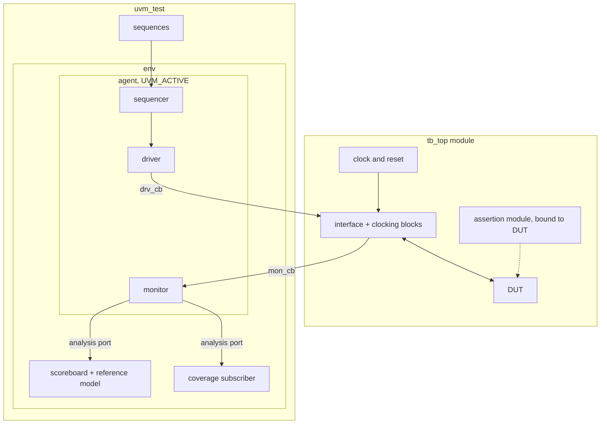

# Testbench Architecture

All modules in this repository use the same folder layout and the same UVM testbench structure. A new block or bus
protocol reuses the structure and only replaces the protocol-specific parts.

## 1. Folder layout

```
<module>/
├── rtl/       design under test
├── tb/        interface, UVM classes, assertions, tb_top, Makefile
├── scripts/   regression, bug injection, GUI and report scripts
└── doc/       verification plan, report, result images
```

## 2. Testbench structure



| Component | Role |
|---|---|
| `tb_top` | Generates the clock, instantiates the DUT and the interface, binds the assertions, puts the virtual interface in `uvm_config_db` and calls `run_test()` |
| Interface | DUT signals and two clocking blocks: `drv_cb` for driving and `mon_cb` for sampling, both with a fixed skew |
| Sequence item | Random stimulus fields and non-random response fields |
| Sequences | One sequence per scenario. Tests select sequences and never access signals |
| Driver | Turns one item into signal activity with the correct timing |
| Monitor | Observes the bus only and broadcasts what it sees. It does not depend on the driver, so the agent also works in passive mode |
| Scoreboard | Takes monitor items through a `uvm_tlm_analysis_fifo`, predicts the result with a reference model and reports PASS or FAIL in `report_phase` |
| Coverage | `uvm_subscriber` that samples a covergroup on every monitored item |
| Assertions | Design rules checked every clock, attached to the DUT with `bind` so internal signals are visible |

Rules followed in every module:

- Stimulus (sequences) is separate from timing (driver).
- Observation (monitor) is separate from stimulus.
- Checking (scoreboard, assertions) is separate from observation.
- Only the driver, the monitor and the assertion module access signals. Everything else exchanges transactions.

## 3. Pass criteria

A simulation run passes only if all of the following hold:

- `UVM_ERROR` and `UVM_FATAL` counts are 0
- the simulator log has no `** Error` line (assertion failures are reported this way)
- the scoreboard prints `SCOREBOARD CHECK PASSED`

The scripts in each module's `scripts/` folder apply these rules, so a run cannot pass on the UVM summary alone.

## 4. Modules

| Module | Design | Status |
|---|---|---|
| [`00_uvm_fifo`](00_uvm_fifo/) | Synchronous FIFO, 8 bit × 32 | Verified. Report and open items in the module README |
| APB slave | 8 × 32-bit register bank | Planned |
| AXI4-Lite, AXI4, AHB-Lite | Bus slaves | Planned |

## 5. Adding a module

1. Copy the folder layout from section 1.
2. Write the interface with `drv_cb` and `mon_cb` clocking blocks.
3. Reuse the component split from section 2. Only the sequence item, driver, monitor and reference model are protocol specific.
4. Write the verification plan first and map each feature to a test, a coverage bin or an assertion.
5. Add the module to the table in section 4.
