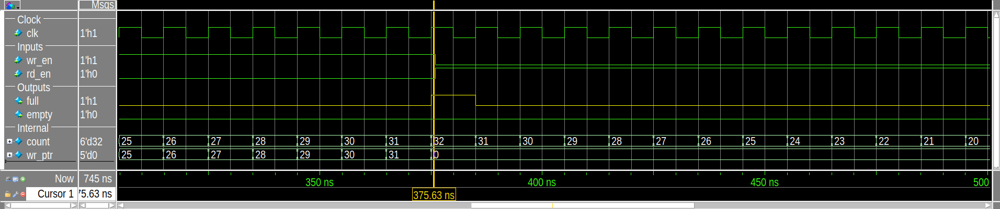

# SystemVerilog / UVM Verification Projects

Functional verification of digital blocks and bus interfaces with SystemVerilog and UVM 1.1d on Questa.
Each module has its own UVM environment, verification plan, regression scripts and a report with waveforms and
coverage results. All modules share the structure described in [ARCHITECTURE.md](ARCHITECTURE.md).

## Modules

| Module | Design | Highlights | Status |
|---|---|---|---|
| [00_uvm_fifo](00_uvm_fifo/) | Synchronous FIFO, 8 bit × 32 | 20/20 regression runs, 100% functional coverage, 10 assertions, 5/5 injected bugs detected | Done ([report](00_uvm_fifo/doc/report/FIFO_Verification_Report.pdf)) |
| APB slave | 8 × 32-bit register bank | | Planned |
| AXI4-Lite, AXI4, AHB-Lite | Bus slaves | | Planned |

## Synchronous FIFO



- Layered UVM environment: agent with clocking-block driver and monitor, queue-model scoreboard, coverage subscriber
- Assertions bound to the RTL check flags, pointers and the occupancy counter every cycle
- Regression over 4 tests and 5 seeds with merged code and functional coverage
- Bug injection: 5 RTL bugs behind `` `ifdef `` switches, each run against every test and seed
- Weaknesses found in the testbench during the bug campaign are listed as open items

Details: [00_uvm_fifo/README.md](00_uvm_fifo/README.md)

## Quick start

```bash
cd 00_uvm_fifo/tb
make regress        # 4 tests x 5 seeds, prints PASS/FAIL table and coverage
make bugs           # injects each RTL bug and reports which checks caught it
```

## Repository layout

```
.
├── README.md
├── ARCHITECTURE.md        common testbench structure and pass criteria
└── 00_uvm_fifo/
    ├── rtl/               design under test
    ├── tb/                UVM testbench, assertions, Makefile
    ├── scripts/           regression, bug injection, GUI and report scripts
    └── doc/               verification plan, report, result images
```

## Tools

Questa Sim-64 2021.2, UVM 1.1d, SystemVerilog IEEE 1800-2017. Report generation uses Python 3 and WeasyPrint.

## Author

Vũ Minh Quân
